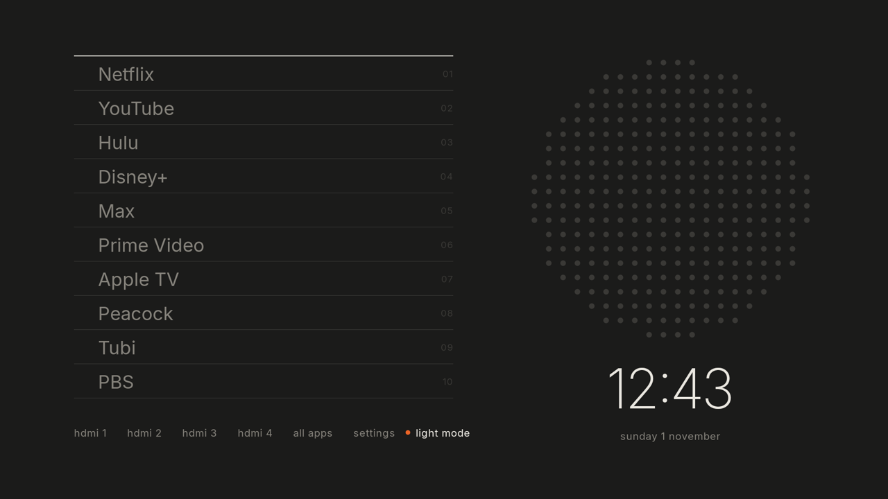

# kyoto

Make a slow Android TV fast again from your computer, without rooting it, and with every change reversible.

kyoto has two parts:

- **`kyoto` CLI** (Bun + TypeScript): talks to the TV over adb. It measures the TV, disables unused packages in small verified batches, tunes settings, swaps the home screen, and rolls any of it back.
- **Kyoto Home** (`launcher/`): a minimal Android TV launcher. It shows a text list of your apps, a speaker grille and a clock, with no ads, rows or previews. It uses about 25–35 MB of memory, against 136–266 MB for the stock launcher on the reference TV.



## Why your TV is slow

Most "slow" Android TVs are short of memory, not CPU. A typical TV has 1.5–2 GB of RAM, and the stock launcher, preinstalled channel apps and recommendation services keep a large share of it busy in the background. When you open an app, Android's low-memory killer evicts whatever else is running. Apps "crash" when you switch back to them, and every launch is a cold start.

On the reference TV (2023 Hisense, Android 10, 2 GB), a single YouTube launch killed 8 background processes, Netflix among them. The CPU was already at its maximum clock. Freeing memory was the only fix that worked. The full story and data are in [the case study](docs/case-study/hisense-huangshan/README.md).

| Reference TV | Before | After |
|---|---|---|
| Home screen memory (PSS) | 136–266 MB | 23–33 MB |
| Background apps disabled | — | ~225 MB resident freed |
| Low-memory kills per measurement | 5–15 | 0–1 |
| Netflix / YouTube cold start | 355–406 / 527–667 ms (spikes to 1.16 s) | 390 / 558 ms |

Cold starts barely change because they are bound by the chip. The gain is that apps stay resident, so going back to one is a ~80 ms hot start instead of a full relaunch.

## Use it with an AI coding agent

This repo is written so an AI coding agent (Claude Code, Codex, Cursor, …) can drive it end to end. Open a terminal in an empty folder and tell your agent:

> Read https://github.com/nathanology/kyoto-android-tv-improvement-guide and follow its AGENTS.md to speed up my Android TV. The TV's IP address is 192.168.1.50.

The agent clones the repo, checks your tools, connects to the TV, and walks you through each decision. You stay in the loop at the points that need a person: accepting the debugging prompt on the TV, choosing which apps your household uses, and running each `--apply` step in your own terminal with the remote in hand. kyoto enforces that last one: it refuses to change the TV from a shell where nobody can answer "does the remote still work?" (exit code 3).

## Do it yourself

You need a computer on the same network as the TV, [Bun](https://bun.sh) ≥ 1.1, and adb ([platform-tools](https://developer.android.com/tools/releases/platform-tools)).

```sh
git clone https://github.com/nathanology/kyoto-android-tv-improvement-guide kyoto && cd kyoto
bun install
bun kyoto connect 192.168.1.50:5555   # accept "Allow USB debugging?" on the TV
bun kyoto init my-tv                  # or `bun kyoto profiles` if your TV already has one
bun kyoto suggest                     # what's safe to disable on this TV, and why
bun kyoto suggest --write             # mark the "safe" ones for batch 1
bun kyoto debloat --batch 1           # dry run: shows the plan
bun kyoto debloat --batch 1 --apply   # do it, verify apps + remote, auto-revert on failure
```

**[docs/GUIDE.md](docs/GUIDE.md)** is the full walkthrough: enabling debugging on Android TV and Google TV, measuring, choosing what to disable, tuning, installing Kyoto Home, undoing everything, and troubleshooting.

## Safety model

- **Disable, never uninstall.** `pm disable-user` is reversible with `pm enable`. The worst case is a factory reset, which re-enables everything.
- **Dry run by default.** Nothing on the TV changes without `--apply`. The one side effect: a `home set` dry run opens the new launcher once to check that it works.
- **Snapshot before every batch.** Disabled packages, all three settings namespaces, and background state for affected apps. `rollback` diffs the live TV against a snapshot and restores the difference. Restores are idempotent.
- **A guard that can't be bypassed** (`cli/guard.ts`). *Lifeline* packages (network stack, adb shell, System UI, settings, package installer, the active home screen) are never touched; losing one could cut your computer off from the TV. *Protected* packages (Play Services, Play Store, WebView, DRM, remote, voice, Bluetooth, tuner/HDMI, launchers) need an exact `--allow <pkg>`.
- **Verified batches.** After a batch, kyoto launches your main apps, checks they reach the foreground without crashing, then asks you to try the remote. Anything but `y` within 90 s reverts the batch and verifies the revert.

## What works where

| | Status |
|---|---|
| Hisense Android TV 10, MT5895 (`hisense-huangshan`) | Reference device; every feature used daily |
| Other Android TV / Google TV devices | Should work. Start with `kyoto init` and the "safe" batch; [share a profile](CONTRIBUTING.md) when it does |
| macOS | Tested |
| Linux | Unit tests run in CI; same commands |
| Windows | Untested. Bun and adb both run there; reports welcome |

## Repository map

```
AGENTS.md     playbook for AI agents (start here if you are one)
docs/         GUIDE.md (walkthrough), REFERENCE.md (commands, files, exit codes), case study
cli/          kyoto CLI: adb transport, guard, snapshots, batches, profiles, measurement, crash log
profiles/     one folder per TV model: profile.json, packages.json, tune.json
catalog/      shared knowledge about packages: what each is and how risky disabling it is
launcher/     Kyoto Home (Android, Java, no dependencies)
test/         unit tests against FakeTv, which replays real TV output from test/fixtures/
state/        (git-ignored) your TV's snapshots, change log, crash log and measurements
```

## Contributing

Profiles for new TVs and catalog entries are the most useful contributions. See [CONTRIBUTING.md](CONTRIBUTING.md).

## Disclaimer

kyoto changes system settings on your TV over a debugging interface. Its changes are designed to be reversible, and it has been tested on one TV model. You use it at your own risk. Nothing here is affiliated with Google, Hisense or any TV maker.

## License

[MIT](LICENSE). The Inter typeface is under the SIL Open Font License ([launcher/FONT-LICENSE-Inter.txt](launcher/FONT-LICENSE-Inter.txt)).
